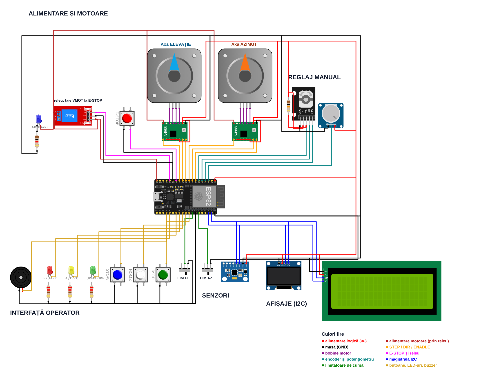
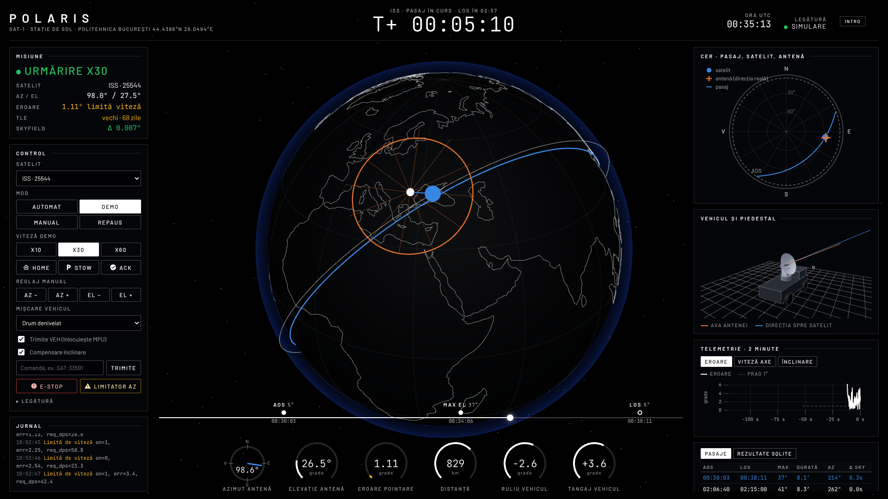
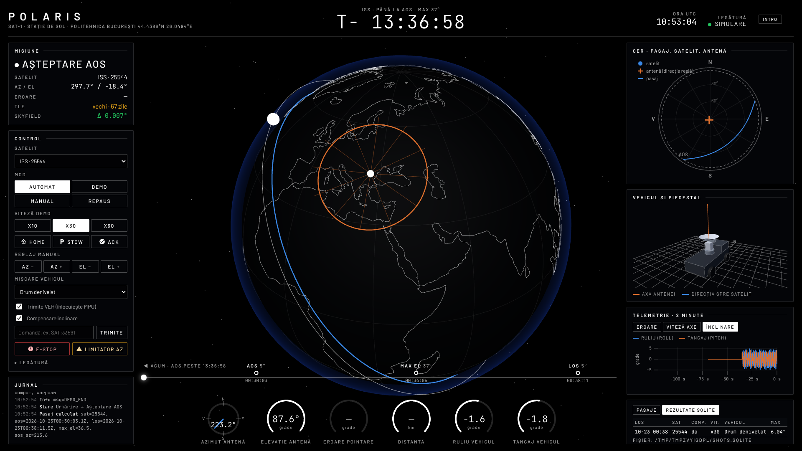
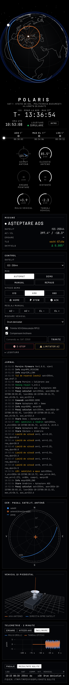
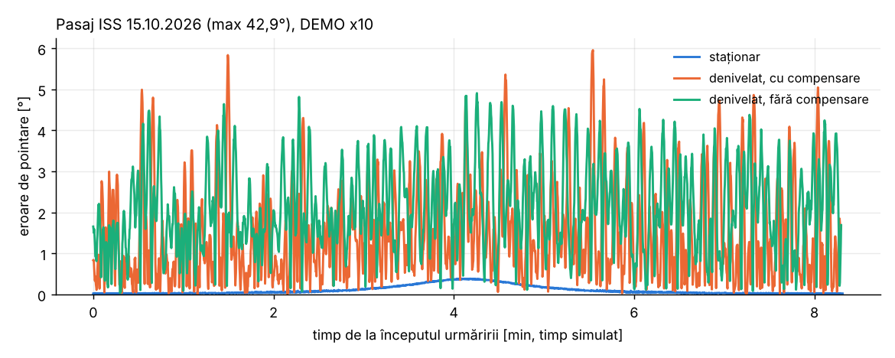
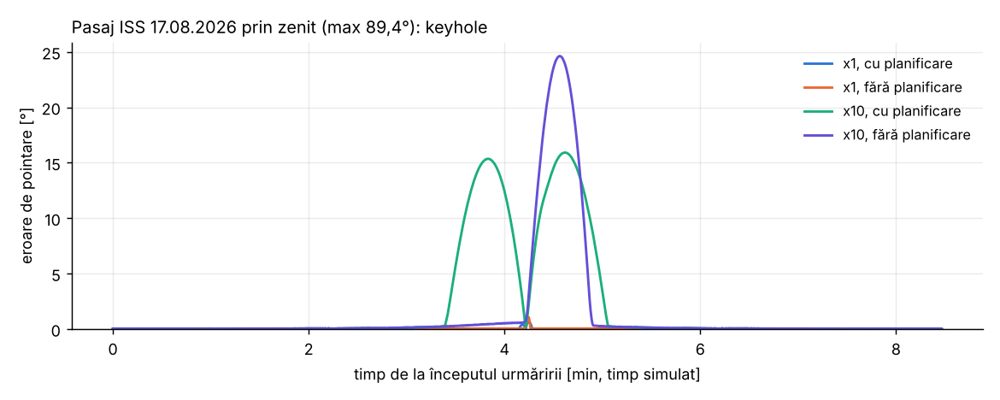
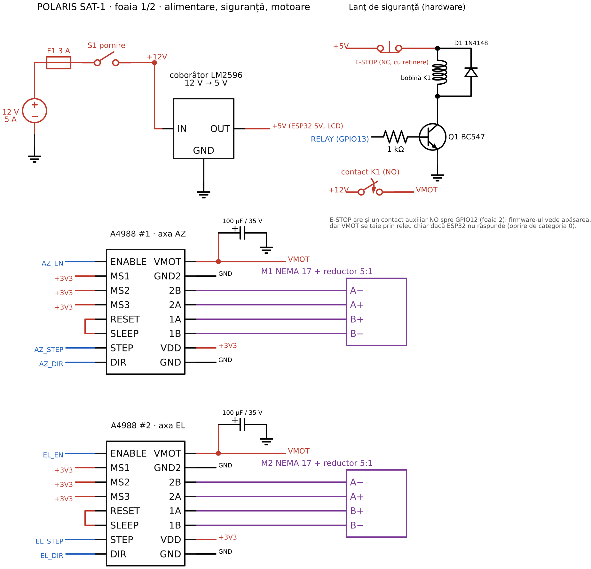
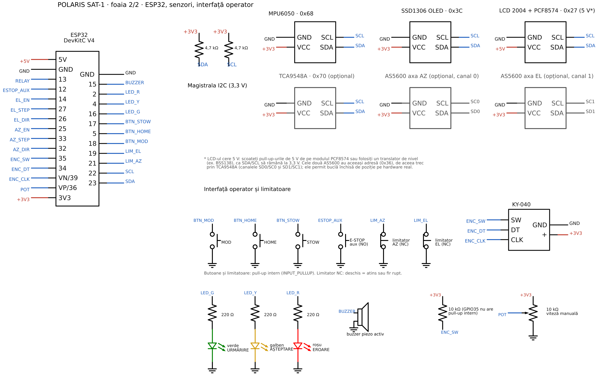

# POLARIS SAT-1

[English](README.md) · **Română**

**Antenă de urmărire a sateliților, montată pe vehicul, cu compensarea înclinării.**
Proiect la Sisteme Mecatronice Avansate.





Cuprins:

1. [Ce este](#1-ce-este)
2. [Arhitectură și structura proiectului](#2-arhitectură-și-structura-proiectului)
3. [Tabelul de pini](#3-tabelul-de-pini)
4. [Demo în Wokwi, pas cu pas](#4-demo-în-wokwi-pas-cu-pas)
5. [Legătura Wokwi → dashboard](#5-legătura-wokwi--dashboard)
6. [Simulare fără Wokwi](#6-simulare-fără-wokwi)
7. [Matematica](#7-matematica)
8. [Verificare și rezultate](#8-verificare-și-rezultate)
9. [Montaj fizic](#9-montaj-fizic)
10. [Limitele simulării și rezolvarea lor pe hardware real](#10-limitele-simulării-și-rezolvarea-lor-pe-hardware-real)

---

## 1. Ce este

POLARIS SAT-1 este un suport de antenă cu două axe (azimut și elevație), acționat de două motoare
pas cu pas. Suportul stă pe un vehicul și ține antena îndreptată spre un satelit real:

- își ia ora exactă prin internet (NTP);
- descarcă elementele orbitale (TLE) de la CelesTrak;
- calculează cu modelul SGP4 unde se află satelitul văzut de la Politehnica București
  (44,4386° N, 26,0494° E, 80 m);
- măsoară cât de înclinat este vehiculul (accelerometrul MPU6050);
- corectează comanda motoarelor astfel încât antena să rămână pe satelit chiar dacă vehiculul
  e pe o pantă sau se clatină.

Sateliți predefiniți: **ISS (25544)**, **NOAA 19 (33591)**, **NOAA 18 (28654)** și un satelit
geostaționar, **Es'hail 2 / QO-100 (43700)**, folosit de radioamatorii din Europa. Se poate cere
orice alt număr NORAD prin comanda `SAT:<id>`.

**Numele.** Polaris este Steaua Polară, punctul fix după care s-a orientat navigația timp de
secole. Antena face același lucru în sens invers: rămâne fixată pe o țintă în timp ce suportul
ei se mișcă. SAT-1 înseamnă primul prototip al sistemului de urmărire a sateliților.

**Echivalente reale.**

- Antenele SATCOM-on-the-move (COTM) de pe vehiculele militare și de intervenție, de exemplu
  terminalele Ku/Ka de la Cobham, Gilat sau Hughes.
- Antenele maritime stabilizate VSAT (Intellian, KVH), care compensează ruliul și tangajul navei.
- Stațiile de sol mobile pentru sateliți meteo (NOAA APT, Meteor LRPT), folosite pe teren.
- Rotoarele de radioamator Yaesu G-5500 și SPID, comandate de Gpredict sau SatPC32. Acestea sunt
  fixe, fără compensare.

POLARIS reproduce, la scară de laborator, aceeași buclă: predicție orbitală, transformare de
coordonate în cadrul vehiculului, planificarea mișcării și siguranță.

## 2. Arhitectură și structura proiectului

```
           WiFi (Wokwi-GUEST)                       serial JSON 115200
  NTP ──────────┐   CelesTrak TLE                  ┌───────────────────────────────┐
                ▼        ▼                         │  POLARIS Ground Station (web) │
        ┌──────────────────────────┐   telemetrie  │  glob 3D, cer polar, vehicul  │
        │ ESP32 DevKit             │ ─────────────►│  3D, grafice, tabel pasaje,   │
        │  core 0: control 50 Hz   │   evenimente  │  jurnal, verificare skyfield, │
        │    SGP4 10 Hz, stări,    │ ◄──────────── │  rezultate în SQLite          │
        │    compensare, siguranță │   comenzi     └───────────────────────────────┘
        │  core 0: rețea (TLE)     │
        │  core 1: pași motoare    │──► 2× A4988 ──► 2× NEMA 17 + reductor 5:1
        └──────────────────────────┘
          ▲ MPU6050  ▲ limitatoare  ▲ butoane, encoder, pot.  ▼ OLED, LCD, LED-uri, buzzer
```

Ideea principală: **toată logica (orbită, geometrie, urmărire, stări, protocol) stă într-o
bibliotecă C++ fără Arduino**, `firmware/lib/polaris_core`. Aceasta se compilează pentru ESP32,
dar și nativ pe PC, pentru teste. O copie Python identică (`ground_station/polaris_gs/sim`) rulează
în dashboard când nu există Wokwi. Un test compară cele două implementări pas cu pas.

```
polaris/
├── firmware/                      PlatformIO, ESP32
│   ├── platformio.ini             medii: esp32dev_sim, esp32dev_hw, esp32dev_qemu
│   ├── wokwi.toml, diagram.json   simularea Wokwi (portul RFC2217 4000)
│   ├── include/pins.h             harta pinilor
│   ├── src/main.cpp               task-uri FreeRTOS, motoare (AccelStepper), IMU
│   ├── src/hmi.cpp                LCD, OLED, butoane, encoder, buzzer, LED-uri
│   ├── src/net.cpp                WiFi, NTP, descărcarea TLE (HTTPS)
│   ├── lib/polaris_core/          logica portabilă: pc_orbit, pc_geometry, pc_tracking,
│   │                              pc_filter, pc_protocol, pc_controller, pc_config
│   ├── lib/sgp4_vallado/          SGP4 Vallado 2020 (sursa de referință)
│   └── test_native/               test g++ al logicii, scenarii de stări
├── ground_station/                dashboard web (server Python + pagină) + copia Python a firmware-ului
│   ├── polaris_gs/core/           geometrie, orbită, urmărire, protocol, TLE de rezervă
│   ├── polaris_gs/sim/            controller.py (copia firmware-ului), runner.py
│   ├── polaris_gs/server.py       server web aiohttp, WebSocket spre pagină
│   ├── polaris_gs/hub.py          legătură, istoric telemetrie, SQLite, skyfield, mișcare vehicul
│   ├── polaris_gs/web/            pagina: glob, cer polar, vehicul 3D, grafice (three.js, uPlot)
│   └── tests/                     pytest (89 de teste)
├── tools/
│   ├── wokwi/                     generare, verificare și randare diagram.json; pachet wokwi.com
│   ├── experiments.py             experimentele din secțiunea 8
│   ├── screenshots.py             capturile dashboard-ului (Chromium headless)
│   ├── qemu_smoke.py              rulează binarul real ESP32 în QEMU
│   └── schematic.py               schema electrică pentru montajul fizic
└── docs/
    ├── img/                       capturi
    ├── results/                   tabele, CSV, grafice, SQLite
    └── hardware/                  schema electrică (svg, png), lista de componente
```

**Stări** (fiecare schimbare trimite evenimentul `MODE` pe serial):

| Stare | Ce face |
|---|---|
| BOOT | WiFi, NTP, TLE, ecranul de pornire cu versiunea |
| HOMING | ambele axe caută limitatorul, apoi își fixează originea; peste 45 s → FAULT |
| IDLE | stă pe loc, motoare active |
| WAIT_AOS | a calculat următorul pasaj și așteaptă la azimutul de răsărire (sau în STOW) |
| ACQUIRE | merge spre satelit; trece în TRACK când eroarea scade sub 1° |
| TRACK | urmărește satelitul cât timp elevația > 5° |
| STOW | poziție de parcare (azimut 0°, elevație 90°) |
| MANUAL | encoderul mișcă axa aleasă, potențiometrul dă viteza |
| DEMO | sare în timp la următorul pasaj bun și îl rulează accelerat x10, x30 sau x60 |
| ESTOP | motoarele sunt oprite; ieșirea cere eliberarea butonului și confirmare (HOME sau `ACK`) |
| FAULT | limitator atins în afara homing-ului sau homing expirat; ieșirea cere confirmare |

**Protocol serial** (115200, o linie JSON pe mesaj):

```
telemetrie, 10 Hz:
{"t_utc":"2026-10-15T03:44:48.7Z","sat":25544,"sat_az":217.90,"sat_el":5.31,"range_km":1838.0,
 "cmd_az":217.90,"cmd_el":5.31,"ant_az":217.94,"ant_el":5.27,"roll":0.00,"pitch":0.00,"yaw":90.00,
 "err_deg":0.059,"mode":"TRACK","next_aos":"...","next_los":"...","max_el":42.9,"warp":30,
 "comp":1,"kh":0,"src":"NET","tle_age":60.0,"tle_fb":1,"axis":"AZ"}
evenimente:
{"ev":"BOOT"} {"ev":"MODE","from":..,"to":..} {"ev":"HOME_OK"} {"ev":"PASS",..} {"ev":"AOS",..}
{"ev":"LOS","max_err":..,"rms_err":..,"n":..,"comp":..,"warp":..} {"ev":"KEYHOLE"} {"ev":"RATE_LIMIT"}
{"ev":"WRAP"} {"ev":"ESTOP"} {"ev":"FAULT","reason":..} {"ev":"ACK"} {"ev":"CMD"} {"ev":"ERR"} {"ev":"INFO"}
comenzi (text, o linie):
SAT:25544   MODE:AUTO|MANUAL|DEMO|IDLE|STOW   WARP:10|30|60   VEH:roll,pitch,yaw   VEH:OFF
JOG:AZ,5.0   HOME   STOW   ACK   COMP:0|1
```

## 3. Tabelul de pini

| Funcție | GPIO | Componentă | Observații |
|---|---|---|---|
| AZ DIR | 32 | A4988 #1 DIR | |
| AZ STEP | 33 | A4988 #1 STEP | |
| AZ ENABLE | 25 | A4988 #1 ENABLE | activ LOW |
| EL DIR | 26 | A4988 #2 DIR | |
| EL STEP | 27 | A4988 #2 STEP | |
| EL ENABLE | 14 | A4988 #2 ENABLE | activ LOW |
| MS1, MS2, MS3 | 3V3 | ambele drivere | 1/16 micropas, fixat din cablaj |
| E-STOP | 12 | buton E-STOP | INPUT_PULLUP, apăsat = LOW, întrerupere pe front |
| Releu | 13 | modul releu (VMOT) | HIGH = motoare alimentate |
| Potențiometru | 36 (VP) | potențiometru | ADC1, viteza în MANUAL |
| Encoder CLK | 39 (VN) | KY-040 CLK | numai intrare |
| Encoder DT | 34 | KY-040 DT | numai intrare |
| Encoder SW | 35 | KY-040 SW | numai intrare, pull-up extern 10 kΩ |
| I2C SDA | 23 | MPU6050, OLED, LCD | |
| I2C SCL | 22 | MPU6050, OLED, LCD | |
| Limitator AZ | 21 | limitator NC la GND | pull-up intern, HIGH = atins sau fir rupt |
| Limitator EL | 19 | limitator NC la GND | idem |
| Buton MOD | 18 | buton | AUTO → MANUAL → DEMO → AUTO |
| Buton HOME | 5 | buton | homing; în ESTOP/FAULT = confirmare |
| Buton STOW | 17 | buton | parcare |
| LED verde | 16 | LED + 220 Ω | TRACK (fix), ACQUIRE (clipește) |
| LED galben | 4 | LED + 220 Ω | așteptare (fix), HOMING (clipește) |
| LED roșu | 2 | LED + 220 Ω | ESTOP (fix), FAULT (clipește) |
| Buzzer | 15 | buzzer | AOS, LOS, alarme |

Adrese I2C: MPU6050 0x68, OLED SSD1306 0x3C, LCD PCF8574 0x27.

**Mecanica și rezoluția.** Motor de 200 pași/rotație × micropas 1/16 × reductor 5:1 =
**16000 micropași pe rotația antenei**, adică **0,0225° pe micropas**. Fasciculul unei antene
Yagi de 70 cm are 30-40°, iar al unei parabole de 1 m în banda L are aproximativ 13°. Rezoluția
este deci de câteva sute de ori mai fină decât e nevoie; reductorul este ales mai ales pentru
cuplu.

**Culorile firelor în Wokwi** (aceeași legendă apare și pe diagramă):

| Culoare | Semnificație |
|---|---|
| roșu | alimentare logică 3V3 |
| roșu închis | alimentarea motoarelor, prin releu |
| negru | masă (GND) |
| portocaliu | STEP / DIR / ENABLE |
| mov | bobinele motoarelor |
| magenta | E-STOP și releu |
| turcoaz | encoder și potențiometru |
| albastru | magistrala I2C |
| verde | limitatoare de cursă |
| galben | butoane, LED-uri, buzzer |

## 4. Demo în Wokwi, pas cu pas

### Varianta A: Wokwi pentru VS Code (recomandată, are legătură cu dashboard-ul)

1. Instalați VS Code, extensia **PlatformIO IDE** și extensia **Wokwi Simulator**. Activați
   licența gratuită Wokwi: F1 → „Wokwi: Request a New License”.
2. Deschideți folderul `firmware/` în VS Code.
3. Compilați varianta de simulare:
   ```
   pio run -e esp32dev_sim
   ```
   Rezultă `.pio/build/esp32dev_sim/firmware.factory.bin`, pe care îl citește `wokwi.toml`.
4. F1 → **„Wokwi: Start Simulator”**. Se deschide circuitul și începe simularea.

### Varianta A, totul din VS Code cu task-urile proiectului

Deschideți tot folderul `polaris` în VS Code (`code C:\polaris`). `.vscode/tasks.json` are
task-uri gata făcute (Terminal → Run Task…); VS Code recomandă și cele două extensii necesare.

1. O singură dată: **Run Task → „POLARIS: instalare dashboard”** (mediul Python al paginii web).
2. O singură dată: F1 → **„Wokwi: Select Config File”** → `firmware/wokwi.toml`.
3. De fiecare dată: **Ctrl+Shift+B** („POLARIS: firmware + dashboard (Wokwi)”): compilează
   firmware-ul, apoi pornește pagina web la http://localhost:8080, care așteaptă Wokwi.
4. F1 → **„Wokwi: Start Simulator”**. Pagina se conectează singură în cel mult 2 secunde.

Alte task-uri: „POLARIS: dashboard (simulare internă)” (pagina fără Wokwi) și
„POLARIS: compilare firmware (Wokwi)”.

### Varianta B: în browser, pe wokwi.com

1. Generați un folder plat cu toate sursele:
   ```
   python tools/wokwi/make_web_bundle.py
   ```
   Rezultatul este în `build/wokwi_web/`: `sketch.ino`, fișierele `.cpp/.h`, `diagram.json` și
   `libraries.txt`.
2. Pe wokwi.com creați un proiect nou „ESP32”. Înlocuiți `diagram.json`, încărcați celelalte
   fișiere (meniul de fișiere → „Upload file(s)”) și apăsați Start.
3. Atenție: wokwi.com compilează într-o partiție de 1,25 MB, iar firmware-ul ocupă 92,4% din ea
   (a fost verificat cu aceeași compilare locală). Nu are port serial spre dashboard; pentru
   legătura cu dashboard-ul folosiți varianta A.

### Ce încercați și ce vedeți

Tastele scurte funcționează după un clic pe zona circuitului.

| Acțiune | Ce vedeți |
|---|---|
| Porniți simularea | OLED: ecranul de pornire „POLARIS”, „fw 1.0.0”. LCD: „POLARIS SAT-1”, „firmware 1.0.0”, apoi pașii WiFi, NTP, TLE pe ultimul rând. Serial: `{"ev":"BOOT",...}` și mesaje `INFO`. |
| Așteptați 5-10 s | Starea HOMING: LED-ul galben clipește, ambele motoare se rotesc spre capătul de cursă. În build-ul de simulare, limita se consideră atinsă după un număr cunoscut de pași. Apoi `HOME_OK`. |
| După homing | WAIT_AOS: LCD-ul arată satelitul (ISS), următorul AOS, elevația maximă și numărătoarea inversă. Antena merge la azimutul de răsărire. LED galben fix. |
| Butonul **MOD** (tasta `m`) de două ori | AUTO → MANUAL → DEMO. În DEMO, sistemul sare la următorul pasaj ISS bun (elevația maximă ≥ 20°) și îl rulează de 30 de ori mai repede. |
| În DEMO, la AOS | Bip scurt, ACQUIRE (verde clipește), apoi TRACK (verde fix). Motoarele urmăresc satelitul; OLED-ul desenează traiectoria pe cerul polar. |
| Mutați glisorul de pe **MPU6050** (accel X/Y) | Roll și pitch se schimbă pe OLED, iar comanda motoarelor se modifică astfel încât antena să rămână pe satelit (compensare). |
| La LOS | Bip dublu, evenimentul `LOS` cu eroarea maximă și RMS, apoi calculul următorului pasaj. |
| **MOD** încă o dată | AUTO: urmărire în timp real a pasajelor reale. |
| Butonul **MOD** până la MANUAL | Encoderul mută azimutul cu 0,5° pe clic; apăsarea encoderului comută pe elevație. Potențiometrul dă viteza (1-20°/s). |
| Butonul **STOW** (tasta `s`) | Antena merge la azimut 0°, elevație 90°. |
| Butonul **E-STOP** (tasta `e`) | Imediat: releul cade (LED-ul albastru „MOTOARE” se stinge), ENABLE se dezactivează, LED roșu fix, buzzer, `{"ev":"ESTOP"}`. |
| **HOME** (tasta `h`) după E-STOP | Confirmare (`ACK`), apoi homing din nou. Dacă E-STOP este încă apăsat, apare `ERR ESTOP_ACTIVE`. |
| Mutați glisorul unui **limitator** în afara homing-ului | Este simulat un fir rupt sau o depășire de cursă: FAULT `LIMIT_AZ` sau `LIMIT_EL`, LED roșu clipește. Readuceți glisorul, apoi HOME. |
| Scrieți în monitorul serial `SAT:33591` | Comută pe NOAA 19, descarcă TLE-ul și calculează pasajul. |
| `WARP:60`, `MODE:DEMO` | DEMO de 60 de ori mai rapid. |
| `VEH:5,-3,120` | Trimite atitudinea vehiculului manual (roll 5°, pitch −3°, yaw 120°). `VEH:OFF` revine la MPU6050. |
| `SAT:43700` | Satelitul geostaționar: punct fix pe cer, fără AOS/LOS. Antena stă fixă (cu compensare). |

## 5. Legătura Wokwi → dashboard

Dashboard-ul („POLARIS Ground Station”) este o **pagină web**. Un server mic în Python
(`python -m polaris_gs`) vorbește cu controllerul și servește pagina la
**http://localhost:8080**; browserul se deschide singur. Serverul e necesar pentru că browserul
nu poate deschide singur portul RFC2217 al Wokwi sau un port COM. Tot el păstrează rezultatele în
SQLite și face verificarea cu skyfield.

`wokwi.toml` conține `rfc2217ServerPort = 4000`. Cât timp simularea rulează în VS Code, portul
serial al ESP32 este disponibil pe `localhost:4000`:

```
cd ground_station
pip install -e .
python -m polaris_gs --link rfc2217://localhost:4000
```

Pentru o placă ESP32 reală: `python -m polaris_gs --link COM3` (Windows) sau
`--link /dev/ttyUSB0` (Linux). Legătura se poate schimba și din pagină (panoul „Legătură”).
Alte opțiuni: `--port 8080` (portul web), `--host 0.0.0.0` (pagina deschisă de pe telefon, din
aceeași rețea), `--no-browser`, `--db <fișier.sqlite>`.

```
 Wokwi / ESP32 ──JSON serial──► server polaris_gs (Python) ──WebSocket──► pagina din browser
                ◄──comenzi────  legătură, SQLite, skyfield  ◄──butoane───  three.js, uPlot
```

La prima vizită pagina rulează un intro scurt: titlul, ce face sistemul, un sondaj GO / NO-GO făcut
din date reale și apoi apropierea globului. Rulează o singură dată pe browser; butonul INTRO sau
`?intro=1` îl reiau, Esc îl sare.

Pagina are un aspect de centru de control al misiunii: globul ocupă tot ecranul, un ceas T−/T+
numără până la AOS, o bandă de timp arată AOS, elevația maximă și LOS, iar cadrane circulare arată
antena și vehiculul.

Ce arată pagina:

- **Glob 3D** (three.js): Pământul, orbita, urma la sol, conul de vizibilitate și satelitul.
  Se rotește prin tragere cu mouse-ul, rotița face zoom.
- **Cerul polar**: traiectoria pasajului, poziția satelitului (albastru) și unde privește antena
  în realitate (crucea portocalie).
- **Vehicul 3D** (three.js): vehiculul înclinat după roll, pitch și yaw, cu antena rotită exact ca
  motoarele. Linia portocalie arată axa antenei, iar linia albastră direcția reală spre satelit;
  când se suprapun, urmărirea e bună.
- **Grafice** (uPlot), ultimele 2 minute: eroarea de pointare, viteza axelor, înclinarea
  vehiculului.
- **Pasajele următoare**, cu ora de răsărire verificată cu skyfield (Δ sky), și tab-ul
  **„Rezultate SQLite”** cu pasajele salvate.
- **Controale**: legătură, satelit, mod, warp, HOME, STOW, ACK, profil vehicul, compensare
  on/off, JOG, un câmp pentru orice comandă serială și (doar în simulare) E-STOP și defect de
  limitator.
- **Jurnalul de evenimente**.
- **Verificare skyfield** în antet: serverul recalculează independent poziția satelitului cu
  skyfield și afișează diferența față de firmware (≈ 0,05°, cât permite rotunjirea telemetriei).
- La fiecare LOS, rezultatul pasajului se salvează în **SQLite** (`~/.polaris/polaris.sqlite`),
  cu sau fără compensare, ca să poată fi comparate.

Pagina merge și pe telefon sau tabletă: panourile se așază unul sub altul.

Profilul de vehicul („staționar”, „drum denivelat”, „viraj”, „pantă”) trimite comenzi `VEH`
de 20 de ori pe secundă, ca și cum vehiculul s-ar mișca. Astfel se poate testa compensarea fără
a muta manual glisoarele MPU6050.

## 6. Simulare fără Wokwi

```
cd ground_station
pip install -e ".[dev]"
python -m polaris_gs                 # simulare internă, deschide http://localhost:8080
python -m polaris_gs --online-tle    # simulare internă, TLE descărcat de la CelesTrak
```

Legătura `sim` rulează în server **copia Python a firmware-ului** (`polaris_gs/sim/controller.py`):
aceleași stări, aceleași constante, același SGP4, aceleași mesaje JSON. Motoarele sunt modelate
cu profilul de accelerație al AccelStepper. Toată pagina funcționează identic. În modul `sim`
sunt active și butoanele „E-STOP (simulare)” și „Injectează limitator AZ”.





## 7. Matematica

### 7.1 SGP4: unde este satelitul

TLE-ul (două linii de 69 de caractere) descrie orbita la un moment dat (epoca). SGP4 propagă orbita
până la momentul dorit, ținând cont de forma Pământului (J2, J3, J4), de frânarea atmosferică
(termenul B\*) și, pentru orbite înalte, de efectul Lunii și Soarelui (SDP4). Rezultatul este
poziția în cadrul **TEME** (ecuatorial, legat de stele).

Lanțul de transformări din `pc_orbit.cpp` / `orbit.py`:

1. **TEME → ECEF**: rotație cu unghiul orar sideral GMST (IAU-82) în jurul axei Z.
2. **Stație → ECEF**: lat/lon/alt pe elipsoidul WGS84.
3. **ECEF → ENU** (Est, Nord, Sus) la stație:
   `ENU = R(lat, lon) · (r_sat − r_stație)`.
4. **Azimut și elevație**: `az = atan2(E, N)`, `el = asin(U / |ENU|)`.

Pasajul următor: firmware-ul eșantionează elevația la 2 s pe 24 h, găsește trecerile prin 5° cu
bisecție și maximul cu căutare golden-section. Calculul se face o dată pe pasaj, nu la fiecare ciclu.
Pentru sateliții geostaționari (mișcare medie aproximativ 1 rotație/zi) căutarea este sărită:
satelitul este fie mereu vizibil, fie niciodată.

SGP4 este implementarea de referință a lui Vallado (2020), aceeași de la care provin bibliotecile
python-sgp4 și skyfield. Biblioteca Arduino „SGP4” (Hopperpop), cerută inițial, a fost testată pe
vectorii oficiali SGP4-VER și a dat abateri de sute de metri până la kilometri; de aceea a fost
înlocuită (vezi secțiunea 8).

### 7.2 Transformarea în cadrul vehiculului

Cadrul vehiculului este FLU (x înainte, y stânga, z sus, convenția ROS REP-103). Atitudinea:

```
R = Rz(yaw) · Ry(pitch) · Rx(roll)          (vehicul → lume ENU)
v_vehicul = Rᵀ · v_ENU
```

Yaw se măsoară de la Est, trigonometric, ca în ENU: yaw 90° înseamnă vehicul orientat spre Nord.
Pe cadrul vehiculului:

```
az_suport = atan2(−y, x)      (de la înainte, în sens orar, ca un azimut)
el_suport = asin(z)
```

Fără compensare, comanda ar fi doar `az_suport = az − (90° − yaw)`, `el_suport = el`. Pe o pantă de
8°, aceasta greșește cu până la 8° (experimentul A5).

**Roll și pitch din accelerometru.** Când vehiculul stă, accelerometrul măsoară doar gravitația:

```
roll  = atan2(a_y, a_z)
pitch = atan2(−a_x, √(a_y² + a_z²))
```

Accelerometrul are zgomot și simte și vibrațiile, iar giroscopul derivă în timp. **Filtrul
complementar** le combină: `θ = α·(θ + ω·dt) + (1−α)·θ_accel`, cu α = 0,98. Pe termen scurt
contează giroscopul, iar pe termen lung accelerometrul.

Yaw nu se poate afla din accelerometru. Implicit este fixat (90°); dashboard-ul îl poate trimite
prin `VEH`. Pe hardware real ar veni de la un GPS cu două antene sau de la un magnetometru
(secțiunea 10).

### 7.3 Keyhole și cablu

Suportul azimut-elevație are o **gaură de cheie (keyhole) la zenit**. Când satelitul trece aproape
de verticală, azimutul se schimbă cu până la 180° în câteva secunde. Viteza cerută este
aproximativ `ω_az ≈ ω_sat / cos(el)` și tinde la infinit când el → 90°. Motorul este limitat
la 40°/s și 120°/s².

Soluțiile implementate:

1. **Limitare de viteză cu anticipare.** La începutul pasajului, firmware-ul calculează tot
   profilul de azimut. Îl trece printr-un limitator de viteză înainte-înapoi (fază zero), astfel
   încât antena începe rotirea mai devreme și nu rămâne în urmă după zenit. Eroarea maximă pe
   pasajul prin zenit (89,4°) scade de la 1,09° la 0,68° în timp real (experimentele B1/B2).
2. **Evenimentul `KEYHOLE`**: o dată la planificare (`"pred":1`, cu viteza cerută și cea
   disponibilă), apoi în timpul pasajului când eroarea trece de 0,5° din cauza limitei de viteză
   la elevație peste 70°. Când viteza este saturată din alt motiv (de exemplu o schimbare bruscă
   de yaw), evenimentul se numește `RATE_LIMIT`. Ambele raportează eroarea.
3. **Cablul (cable wrap).** Azimutul are cursă de ±270°, nu 360° continuu, pentru că firele trec
   prin articulație. La începutul pasajului se alege **o singură dată** varianta de azimut
   (θ, θ ± 360°) pentru care tot pasajul rămâne în ±270° cu cea mai mică rotire inițială. Astfel
   antena nu trebuie să se întoarcă la 360° în mijlocul pasajului. Alegerea se anunță cu
   evenimentul `WRAP`.

### 7.4 Compensarea pe vehicul în mișcare

Comanda se recalculează la 50 Hz cu atitudinea filtrată. Matematica este exactă (test: cu compensare, eroarea
rămasă este < 10⁻⁶ ° pe 300 de atitudini aleatoare). Limita practică este **accelerația motoarelor**: pe drumul denivelat
simulat, componentele de 1,5° la 1,9 Hz pe roll și de 1,2° la 2,3 Hz pe pitch cer singure peste
200°/s² (A·ω²), iar motoarele au 120°/s². Experimentele A2/A3/A6 arată exact asta (secțiunea 8).

## 8. Verificare și rezultate

### Ce s-a verificat și cum

| Verificare | Cum | Rezultat |
|---|---|---|
| SGP4 firmware vs vectorii oficiali SGP4-VER (Vallado) | test nativ g++ + pytest | 659 de puncte, abatere maximă 0,12 mm |
| Copia Python vs skyfield (az/el) | pytest, toți sateliții, 24 h | ≤ 0,004° (cerința: < 0,1°) |
| Matematica C++ vs Python (ENU → vehicul, roll/pitch, GMST, wrap, limitare de viteză) | test de paritate, 300 de cazuri aleatoare | diferență < 10⁻⁹ ° |
| Parserul de comenzi C++ vs Python | aceleași 29 de linii, inclusiv cele greșite | aceleași răspunsuri și erori |
| Mașina de stări C++ vs Python | 5 scenarii (demo cu înclinare, keyhole, siguranță, homing expirat, GEO manual) | aceeași secvență de evenimente și telemetrie |
| Teste unitare | `pytest` (89 de teste, inclusiv serverul web și protocolul WebSocket) | toate trec |
| Firmware ESP32 | `pio run`, toate cele 3 medii | 0 avertismente |
| Binarul real ESP32 | QEMU Espressif (`tools/qemu_smoke.py`), comenzi pe UART | BOOT → TLE de rezervă → HOMING → HOME_OK → MANUAL → JOG → SAT:43700 → AUTO → ACQUIRE → TRACK → VEH → STOW → HOME |
| Circuitul Wokwi | linterul oficial `@wokwi/diagram-lint` + `check_pins.py` | 0 erori, 0 avertismente; 23 de pini, toți conform `pins.h` |
| Dashboard web | `tools/screenshots.py` folosește pagina într-un Chromium headless (pornire, DEMO, TRACK, LOS, lățime de telefon) și eșuează la orice eroare JavaScript; capturi verificate vizual | `docs/img/` |

Comenzi:

```
cd ground_station && pytest                       # 89 de teste
make -C firmware/test_native                      # testul nativ g++ (-Wall -Wextra -Werror)
cd firmware && pio run -e esp32dev_sim            # build pentru Wokwi
python tools/experiments.py                       # regenerează docs/results
python tools/screenshots.py docs/img              # capturi (necesită: playwright install chromium)
```

**Memorie (esp32dev_sim):** RAM 25,5% (83 396 B din 327 680 B), Flash 38,5%
(1 211 503 B din 3 145 728 B, partiția `huge_app`).

### Experimente

Eroarea este unghiul real dintre axa antenei și direcția satelitului, cu înclinarea vehiculului
aplicată. Este măsurată la 50 Hz de la AOS la LOS pe copia Python a firmware-ului. Scriptul
`tools/experiments.py` regenerează tot (tabel, CSV, grafice, SQLite).

| ID | Scenariu | Viteză | Max [°] | RMS [°] | P95 [°] |
|---|---|---|---|---|---|
| A1 | staționar | x10 | 0,39 | 0,15 | 0,35 |
| A2 | drum denivelat, cu compensare | x10 | 5,96 | 1,88 | 3,75 |
| A3 | drum denivelat, fără compensare | x10 | 4,91 | 2,37 | 4,01 |
| A4 | pantă 8°, cu compensare | x10 | 1,16 | 0,16 | 0,39 |
| A5 | pantă 8°, fără compensare | x10 | 8,31 | 5,57 | 8,22 |
| A6 | drum denivelat, cu compensare, accelerație x3 | x10 | 1,96 | 0,72 | 1,41 |
| B1 | pasaj prin zenit, cu planificare keyhole | x1 | 0,68 | 0,05 | 0,02 |
| B2 | pasaj prin zenit, fără planificare | x1 | 1,09 | 0,06 | 0,02 |
| B3 | pasaj prin zenit, cu planificare keyhole | x10 | 15,92 | 5,01 | 14,51 |
| B4 | pasaj prin zenit, fără planificare | x10 | 24,62 | 4,94 | 13,84 |

Pasajele folosite: ISS 15.10.2026 03:44 UTC (elevație maximă 42,9°) pentru A și ISS 17.08.2026
03:44 UTC (89,4°) pentru B, ambele calculate din TLE-urile stocate, ca rezultatele să fie
repetabile.





**Interpretare.**

- **Pantă (A4 vs A5):** compensarea reduce eroarea RMS de 35 de ori (5,57° → 0,16°). Aici
  matematica lucrează singură, fiindcă înclinarea e constantă.
- **Drum denivelat (A2, A3, A6):** cu motoarele de bază, compensarea scade RMS doar de la 2,37°
  la 1,88°, iar vârful chiar crește. Motoarele nu pot urmări oscilații de 1,9 Hz la 120°/s² și
  rămân în urmă cu o fază care uneori adună erorile. Cu accelerație x3 (A6), RMS scade la 0,72°.
  Concluzie: pe vehicul, limita e **actuatorul**, nu calculul. Aceasta este motivația
  stabilizatoarelor reale cu motoare directe (secțiunea 10).
- **Keyhole (B):** în timp real, planificarea anticipată reduce vârful de la 1,09° la 0,68°.
  La x10 orice suport de 40°/s pierde satelitul pentru câteva secunde la zenit, dar
  planificarea scade vârful de la 24,6° la 15,9°. Valorile P95 mici arată că eroarea apare doar
  în câteva secunde din jurul zenitului.

## 9. Montaj fizic

- Schema electrică: [`docs/hardware/schematic_power.svg`](docs/hardware/schematic_power.svg)
  (alimentare, siguranță, motoare) și
  [`docs/hardware/schematic_logic.svg`](docs/hardware/schematic_logic.svg)
  (ESP32, senzori, interfață). Se generează cu `python tools/schematic.py`.
- Lista de componente cu prețuri orientative: [`docs/hardware/bom.md`](docs/hardware/bom.md)
  (aproximativ 650 lei fără opționale).





Puncte importante:

- **Alimentare**: 12 V / 5 A → siguranță 3 A → întrerupător. Din 12 V, un coborâtor LM2596 dă
  5 V pentru ESP32 și LCD. ESP32 face 3,3 V intern pentru senzori și logica A4988.
- **Driverele A4988**: câte un condensator de 100 µF / 35 V direct pe VMOT. RESET legat la SLEEP.
  MS1-MS3 la 3,3 V (1/16). Curentul se reglează din Vref înainte de a monta motorul.
- **Lanțul de siguranță este hardware**: E-STOP-ul (contact NC cu reținere) este în serie cu
  bobina releului. Apăsarea lui taie bobina, releul deschide VMOT, iar motoarele se opresc chiar
  dacă ESP32 s-a blocat. Un al doilea contact al butonului (NO) merge la GPIO12, ca firmware-ul să
  știe ce s-a întâmplat, să dezactiveze ENABLE și să ceară confirmare.
- **Limitatoarele sunt NC la masă**: un fir rupt arată ca un limitator atins, deci sistemul
  intră în siguranță (fail-safe).
- **I2C**: pull-up-uri de 4,7 kΩ la 3,3 V. Modulul LCD are pull-up-uri la 5 V; acestea se
  scot sau se folosește un translator de nivel.
- **Opțional**: două AS5600 (encodere magnetice absolute pe axele antenei), prin multiplexorul
  TCA9548A pentru că au aceeași adresă. Ele închid bucla de poziție (secțiunea 10).

Diferențe între circuitul Wokwi și cel fizic (Wokwi nu are toate piesele):

| În Wokwi | În montajul fizic | Motiv |
|---|---|---|
| E-STOP = buton momentan + modul releu comandat de GPIO13 | E-STOP NC cu reținere în serie cu bobina releului | Wokwi nu are buton cu reținere și nici bobină separată |
| Limitatoare = slide switch | micro switch NC | Wokwi nu are limitator mecanic |
| Motoare alimentate direct din releu, fără sursă de 12 V | sursă 12 V, siguranță, LM2596 | Wokwi nu simulează alimentarea |
| Fără condensatoare pe VMOT | 100 µF / 35 V pe fiecare driver | idem |
| LCD direct pe magistrala de 3,3 V | translator de nivel sau pull-up-uri scoase | Wokwi nu simulează nivelurile de tensiune |

## 10. Limitele simulării și rezolvarea lor pe hardware real

| Limita în simulare | Ce înseamnă | Rezolvare pe hardware real |
|---|---|---|
| Homing-ul consideră limita atinsă după un număr fix de pași (`POLARIS_SIMULATION`) | Wokwi nu are o piesă care se mișcă și apasă limitatorul | Build-ul `esp32dev_hw` așteaptă limitatorul real; timeout-ul de 45 s rămâne |
| Motorul Wokwi execută orice pas | Fără pași pierduți, fără inerție, fără rezonanțe | Encodere absolute AS5600 pe axe (deja în schemă) și verificarea poziției după homing; curent reglat corect; accelerații măsurate |
| MPU6050 din Wokwi dă valori statice, fără zgomot și fără vibrații | Filtrul complementar nu e testat la vibrații reale | Montaj elastic al IMU-ului; calibrarea offset-ului la pornire; filtru Kalman sau Madgwick |
| Yaw fix sau trimis din dashboard | Un vehicul real se rotește | GPS cu două antene (heading), IMU cu magnetometru (BNO055), eventual giroscop pe Z integrat între corecții |
| Poziția stației fixă (Politehnica) | Vehiculul se deplasează | Modul GNSS (NEO-6M): poziția actualizată la fiecare secundă în calculul ENU |
| Ora vine prin NTP (WiFi Wokwi-GUEST) | Fără rețea pe teren | Ora din GNSS (PPS) sau un RTC DS3231 |
| TLE descărcat prin WiFi | Pe teren nu există WiFi; TLE-ul îmbătrânește (ISS: aproximativ 1-3 km/zi) | Firmware-ul afișează vârsta TLE-ului și folosește TLE-ul de rezervă marcat „vechi”; pe teren, modem LTE sau actualizare înainte de plecare |
| Viteza motoarelor (40°/s, 120°/s²) limitează compensarea pe drum denivelat | Experimentul A2 | Motoare mai rapide (servo cu buclă închisă, motoare directe BLDC) sau o platformă stabilizată separat (gimbal pe roll/pitch) |
| Keyhole la zenit | Suport az-el | Montaj cu a treia axă (X-Y sau az-el-tilt) sau planificarea din firmware, acceptând o scurtă pierdere |
| Cablu limitat la ±270° | Firele prin articulație | Inel colector (slip ring): azimut continuu |
| Lanțul E-STOP din Wokwi trece prin software (GPIO13 comandă releul) | Nu e o oprire de categoria 0 | E-STOP NC în serie cu bobina releului (schema din secțiunea 9) |
| Timpii pe ESP32 real (SGP4 la 10 Hz, bucla de 50 Hz) au fost verificați doar în QEMU, nu pe placă | QEMU nu are timpi realiști | Măsurare cu `esp_timer_get_time()` pe placă; estimarea (nemăsurată) este de ordinul sutelor de µs pe propagare, mult sub bugetul de 100 ms |

---

### Note despre sursele folosite

- **Pinii și piesele Wokwi** (`wokwi-a4988`, `wokwi-stepper-motor`, `wokwi-mpu6050`,
  `board-ssd1306`, `wokwi-lcd2004` cu `pins: i2c`, `wokwi-ky-040`, `wokwi-relay-module`,
  `wokwi-slide-switch` și celelalte) au fost verificați în documentația oficială `wokwi-docs` și
  în `wokwi-boards` (ESP32 DevKit V1), apoi cu linterul oficial `@wokwi/diagram-lint`.
- **TLE-urile de rezervă** din firmware provin din fișierele Gpredict (epoci: ISS și QO-100
  16.08.2026, NOAA 18/19 22.03.2026). Firmware-ul le marchează ca vechi (`tle_fb: 1`, vârsta în
  zile pe LCD) până când descarcă unele noi de la CelesTrak.
- **Biblioteci**: AccelStepper, U8g2, LiquidCrystal_I2C, Adafruit MPU6050 (cu Adafruit Unified
  Sensor și BusIO) și SGP4 Vallado (inclus în `lib/sgp4_vallado`, licența în același folder).
- Conturul continentelor de pe glob: Natural Earth 1:110m (domeniu public).
- Bibliotecile paginii web, copiate în `ground_station/polaris_gs/web/vendor` ca pagina să meargă
  fără internet: three.js 0.170.0 (MIT), uPlot 1.6.31 (MIT), fonturile Barlow și JetBrains Mono (SIL OFL), Material Design Icons prin @mdi/js
  7.4.47 (Pictogrammers Free License, iconițele sub Apache 2.0).
